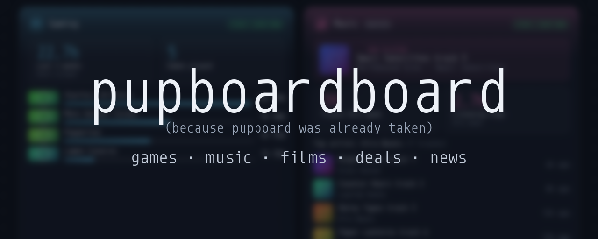

<p align="center">
  
</p>

# pupboardboard

*Because pupboard was already taken.* (The app still calls itself pupboard; the repo got the extra board.)

A colourful, animated homepage that shows your week at a glance:

- **Gaming (Steam):** hours played and which games, over the last 7 days
- **Music:** now playing, tracks and listening time this week, top artists and songs, from **Spotify** (via ListenBrainz, or directly) or your own **Navidrome**
- **Media:** free games and the best Steam sales (works for everyone, no setup), films you've watched on **Letterboxd**, or what's new on your **Jellyfin** server
- **News:** gaming news by default (Steam, GamingOnLinux, game deals, Rock Paper Shotgun), or any RSS/Atom feeds you like

The overview page is the at-a-glance view. Click a card (or use the top nav) for a detail page with more.

**As few keys as possible.** Game deals and news work with no setup at all. Spotify (through ListenBrainz) and Letterboxd only need a username. Only Steam needs a (free) key, because Steam doesn't share playtime any other way.

Everything it talks to is free: no paid APIs, no accounts with us, no tracking. Your keys and passwords stay on your machine.

## Pick how to run it

| You are… | Use |
|---|---|
| Not into terminals, on Windows, macOS or Linux | [The download](#the-easy-way-download-and-double-click) |
| Running a home server with Docker / Dockge / Portainer | [Docker Compose](#docker-compose) |
| Comfortable with Node.js | [From source](#from-source) |

### The easy way: download and double-click

1. Go to the [latest release](https://github.com/puppygirlzone/pupboardboard/releases/latest) and download the zip for your computer:
   - Windows: `pupboard-…-win-x64.zip`
   - Mac with Apple chip (M1 or newer): `pupboard-…-darwin-arm64.zip`; older Intel Mac: `…-darwin-x64.zip`
   - Linux: `pupboard-…-linux-x64.zip`
2. Unzip it anywhere (your Documents folder is fine).
3. Start it:
   - **Windows:** double-click **Start pupboard.bat**. If Windows says "Windows protected your PC", click **More info → Run anyway**.
   - **macOS:** right-click **Start pupboard.command → Open → Open** (only the first time; afterwards just double-click).
   - **Linux:** double-click **start-pupboard.sh** and choose "Run in terminal", or run `./start-pupboard.sh`.
4. Your browser opens the **Settings** page. Fill in what you use and press **Save**. That's it.

Keep the small black window open while you use pupboard; closing it stops pupboard. Nothing gets installed: Node.js is included in the zip, and deleting the folder removes everything.

Next time, start it the same way and bookmark <http://localhost:8742>. To change settings later, click the gear button at the top right.

**Updating:** download the new zip, unzip it, and copy the `data` and `config` folders from your old pupboard folder into the new one.

**On your phone:** in Settings → Network, choose "Any device on my home network", save, and restart pupboard. Then open `http://<your computer's IP>:8742` on your phone.

### Docker Compose

Download [`compose.yaml`](compose.yaml) and [`.env.example`](.env.example) into a folder (or clone the repo), then:

```bash
cp .env.example .env     # fill in what you use
mkdir -p config && cp config/feeds.example.txt config/feeds.txt   # optional: your news feeds
docker compose up -d
```

Open `http://<server-ip>:8742`. This pulls the ready-made image from `ghcr.io` (amd64 and arm64, so a Raspberry Pi 4/5 works too). If it can't be pulled, Compose builds it from the folder instead (needs the full repo).

- Steam play history lives in the `pupboard-data` volume, so the 7-day view survives restarts.
- Inside Docker, `localhost` means the container itself. Use your server's LAN IP for Navidrome and Jellyfin, or put pupboard on the same Docker network as them (see the comments in `compose.yaml`).
- The Settings page is turned off inside Docker; use `.env` there.
- **Updating:** `docker compose pull && docker compose up -d`. In **Dockge**, just press **Update**. Podman: `podman compose` works the same.
- Running your own code changes: `docker compose up -d --build`.

**Quoting in `.env`:** if a password or key contains `$`, `#`, spaces or quotes, wrap it in **single** quotes, e.g. `NAVIDROME_PASSWORD='pa$$ #word'`. Unquoted, Docker Compose expands `$` as a variable and drops anything after ` #`; double quotes still expand `$`.

### From source

Needs [Node.js](https://nodejs.org) 22 or newer.

```bash
git clone https://github.com/puppygirlzone/pupboardboard.git
cd pupboardboard
npm install
npm start
```

Open <http://localhost:8742>, then set things up either with the Settings page (the link with its access code is printed in the terminal) or by copying `.env.example` to `.env` and filling it in. Values in `.env` win over the Settings page. To keep it running in the background on Linux, see [deploy/pupboard.service](deploy/pupboard.service).

### Just looking? Try the demo

```bash
npm install
npm run demo
```

Demo mode shows made-up data and deliberately fails about 25% of requests, so you can see how the dashboard copes. To see the other cards, pick them: `MUSIC_SOURCE=spotify MEDIA_SOURCE=deals npm run demo` (or `listenbrainz` / `letterboxd`).

## Connecting your stuff

Everything below can be filled in on the **Settings** page (gear button, top right) or in `.env`.

| Card | Service | What you need |
|---|---|---|
| Gaming | Steam | Your **profile link** and a free key from <https://steamcommunity.com/dev/apikey> (any domain name works). Set your Steam profile's **Game details** privacy to Public. |
| Music | Spotify via [ListenBrainz](https://listenbrainz.org) | **Just a username.** Make a free ListenBrainz account, connect Spotify there (Settings → Music services), and it records your plays. Also works with YouTube Music, Jellyfin, Plex and others that ListenBrainz supports. |
| Music | Spotify direct (optional) | Live "now playing" straight from Spotify. Spotify only allows this with **Spotify Premium** and your own free developer app: see [Spotify direct](#spotify-direct). |
| Music | Navidrome | Your Navidrome address and normal login. |
| Media | Game deals | **Nothing.** On by default: free-to-keep PC games (from [GamerPower](https://www.gamerpower.com)) and top Steam sales (from [CheapShark](https://www.cheapshark.com), US prices). |
| Media | Letterboxd | **Just a username** (or your profile link). |
| Media | Jellyfin | Your Jellyfin address and an API key (Jellyfin Dashboard → API Keys → **+**). |
| News | RSS / Atom | Nothing: gaming news by default. See [News feeds](#news-feeds). |

**Which service shows on a card:** set "Music card" / "Media card" in Settings (`MUSIC_SOURCE` / `MEDIA_SOURCE`). Automatic picks the first one set up: Navidrome, then Spotify, then ListenBrainz for Music; Jellyfin, then Letterboxd, then game deals for Media.

Keys and passwords stay on the server: the browser only talks to pupboard, and Navidrome/Jellyfin pictures are proxied through it.

### Spotify direct

Spotify's own API needs a developer app per person (since 2026: the app owner must have Premium, and each app allows at most 5 people). If that's too much, use ListenBrainz instead.

1. Open the [Spotify developer dashboard](https://developer.spotify.com/dashboard) and press **Create app**. Any name and description.
2. Under **Redirect URIs**, paste the one shown on pupboard's Settings page, e.g. `http://127.0.0.1:8742/api/spotify/callback` (Spotify doesn't accept `localhost`). Tick **Web API** and save.
3. Copy the app's **Client ID** into pupboard's Settings and press **Save**. (No client secret needed.)
4. Press **Connect Spotify** and allow access. Done: pupboard keeps the sign-in on your computer and refreshes it by itself.

This needs the Settings page, so it works with the download and `npm start`, not inside Docker. Docker users: use ListenBrainz.

## Clock

The clock is 24-hour by default (`CLOCK_FORMAT=12h` for 12-hour). Set `TIME_ZONE` (e.g. `Europe/London`) if the time is wrong: some privacy-focused browsers (Firefox's "resist fingerprinting", LibreWolf, Mullvad Browser) report UTC instead of your real zone. Docker's usual `TZ` also works.

## News feeds

Edit them on the Settings page, or in `config/feeds.txt`, one per line:

```bash
cp config/feeds.example.txt config/feeds.txt
```

```
# lines starting with # are ignored
GamingOnLinux | https://www.gamingonlinux.com/article_rss.php
https://www.reddit.com/r/selfhosted/.rss      <- no name: the feed's own title is used
```

- Edits are picked up automatically, with no restart. In Docker, the `config/` folder is mounted read-only into the container.
- Up to 50 feeds; duplicates are skipped.
- Without the file you get gaming news: Steam News, GamingOnLinux, r/GameDeals and Rock Paper Shotgun. `feeds.example.txt` has more ideas. `feeds.txt` is git-ignored.
- For a short list you can also use `RSS_FEEDS` in `.env` (comma-separated). The file wins if both exist.

## Themes

Pick a theme from the dropdown in the top bar, and switch day/night with the sun/moon button. Your choice is saved in the browser. Until you press the button, day/night follows your system setting.

| Theme | Night | Day |
|---|---|---|
| Default | dark | light |
| [Whale](https://github.com/anufrievroman/whale) | Whale | derived from Whale's colours (no official light variant) |
| [Dracula](https://draculatheme.com/) | Dracula | Alucard |
| [Catppuccin](https://catppuccin.com/palette/) | Mocha | Latte |
| [Camellia](https://github.com/camellia-theme/camellia) | Hope Dark | Hope Light |
| [Rosé Pine](https://rosepinetheme.com/) | Main | Dawn |

A few secondary-text greys are slightly adjusted from the originals so small text stays readable.

## How it handles unreliable services

- Each upstream call has a timeout (8 s) and one retry.
- The last good data is cached. If a source goes down, its card shows that data with an amber **Offline** pill.
- If only part of a source fails, the rest still shows, marked **Partial**, and it retries after 30 s.
- After a failure it waits 30 s before trying again, so a dead server isn't hammered.
- The page never waits more than about 4 s for a slow source; that card shows *Loading* and fills in later.
- If pupboard itself is unreachable, the browser shows its last saved copy.
- The page refreshes every 60 seconds, plus whenever you switch back to the tab.

## Accuracy notes

- **Steam** only reports "last 2 weeks" playtime. pupboard saves your total playtime once an hour and compares against a week ago. Until 7 days of history exist, it shows the 2-week figures and says so.
- **Navidrome** only stores the most recent play of each song, so "tracks this week" and "listening time" are minimums: a song played 5 times counts once.
- **Spotify** only shares your last 50 plays. If all 50 are from this week, the card shows **50+** rather than a made-up total.
- **ListenBrainz** counts every play, repeats included. If most plays have no track length, listening time shows "—" instead of a number that's too low. "Now playing" depends on your music app reporting it, so it can lag a little.
- **Letterboxd**'s feed holds about your last 50 diary entries, so a very busy month shows as "50+".
- **Game deals** prices are in US dollars (CheapShark). If one of the deal sites is down, its number shows "—", not 0.

## All settings

Everything can go in `.env` (see [`.env.example`](.env.example) for the full list with comments). The main ones besides the keys above:

| Setting | Default | What it does |
|---|---|---|
| `PORT` | `8742` | Web port |
| `HOST` | `0.0.0.0` (`127.0.0.1` for the download) | Which network address to listen on |
| `TIME_ZONE`, `CLOCK_FORMAT` | browser's zone, `24h` | Clock |
| `MUSIC_SOURCE`, `MEDIA_SOURCE` | `auto` | Which service fills the Music / Media card |
| `DEALS` | `on` | `off` hides game deals |
| `SETUP_PAGE` | `1` | `0` turns the Settings page off |
| `DATA_DIR` | `./data` | Where settings and Steam history are stored |
| `DEMO_MODE` | `0` | `1` = made-up data |

## Security

The dashboard has no login: anyone who can reach its port can see your stats (but never your keys). Keep it on your home network, or put it behind a reverse proxy with authentication if you want it reachable from outside. The Settings page only works from the computer pupboard runs on, with a code that changes every start. See [SECURITY.md](SECURITY.md) to report a problem.

## Contributing

Issues and pull requests are welcome. Please read [AGENTS.md](AGENTS.md) first: it holds the project's design and safety rules (it's written for AI coding assistants too).

```bash
npm install
npm test          # Node's built-in test runner, nothing extra to install
npm run demo      # check your change in the browser with flaky fake data
```

The tests cover the retry/cache/back-off logic, every source's parsing (Steam, Navidrome, Jellyfin, Spotify, ListenBrainz, Letterboxd, deals, RSS/Atom, including junk and partial responses), the Spotify sign-in and token refresh, the HTTP server under heavy upstream failure, path-traversal and image-proxy safety, the Settings page's access rules, every page and card choice in every state, HTML escaping, theme contrast, and the deployment files. Run `npm test` before and after any change.

### Project layout

```
server/       HTTP server, settings, data sources, demo upstreams
public/       the web page: HTML, CSS (themes.css holds all colours), JS
config/       feeds.example.txt
packaging/    launchers for the release downloads
scripts/      package-release.sh (builds the download zips)
tests/        npm test
```

### Making a release

Tag it (`git tag v1.2.0 && git push --tags`). GitHub Actions then runs the tests, publishes the Docker image, and attaches the download zips to a GitHub Release.

## Credits and licence

pupboard is free software under the [GNU GPL v3 or later](LICENSE).

It bundles [Monoid](https://github.com/larsenwork/monoid) (MIT / SIL OFL, see `public/fonts/monoid/LICENSE.txt`) and [anime.js](https://animejs.com/) (MIT). The download zips include [Node.js](https://nodejs.org) (MIT, see `runtime/LICENSE-node.txt`).

Game deals data comes from [GamerPower](https://www.gamerpower.com) and [CheapShark](https://www.cheapshark.com); cover art for ListenBrainz plays from the [Cover Art Archive](https://coverartarchive.org).

Not affiliated with Valve, Spotify, ListenBrainz, Letterboxd, Navidrome, Jellyfin, GamerPower or CheapShark.
